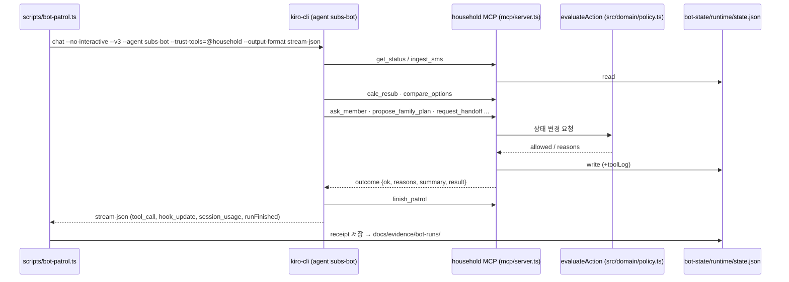

# Design Document — subs-bot

## Overview

봇 = **Kiro CLI 헤드리스 실행 + 커스텀 에이전트 + 프로젝트 MCP 서버**. 제품 고유 로직은 모두 결정적 TypeScript(`src/domain`, `src/bot/tools.ts`)에 있고, 모델은 "무엇을 언제 할지"만 정한다. 숫자·상태 전이·메시지 형식은 도구가 만든다.

## Architecture

## Components and Interfaces

| 구성 | 파일 | 역할 |
|---|---|---|
| 에이전트 | `.kiro/agents/subs-bot.json` | 점검 절차 프롬프트, `tools: ["@household"]`, `permissions`: household 도구 13개 allow, fs_read·fs_write·shell deny |
| 행동 규칙 | `.kiro/steering/bot.md` | B1~B6 (에이전트 resources로 주입) |
| MCP 서버 | `mcp/server.ts`, `scripts/mcp-launch.mjs` | stdio JSON-RPC, 상태 파일 읽기·쓰기 |
| 도구 | `src/bot/tools.ts` | 12개 핸들러, `runTool(state, name, args)` |
| 사람 행동 | `src/bot/human.ts` | 답장·투표·해지 신청 기록. 봇 도구가 아님 |
| 실행기 | `scripts/bot-patrol.ts` | 점검 1회, stream-json 파싱, 영수증 |
| 시나리오 | `scripts/demo-scenario.ts` | 점검 5회 + 사람 행동, `public/replay/demo.json` 생성 |
| 재생 화면 | `src/ui/BotReplay.tsx` | 녹화 기록을 단계별로 보여 줌 |

### 도구 13개

| 도구 | 상태 변경 | 정책 관문 |
|---|---|---|
| `get_status` | 새 답장 읽음 표시 | — |
| `ingest_sms` | 거래 기록, 해지 후 청구면 사건 재개방 | `observe_charge` |
| `calc_resub`, `compare_options` | 계산 결과 저장(숫자 검증용) | — |
| `compare_channels` | 경로별 가격 비교 결과 저장(숫자 검증용) | — |
| `ask_member` | 질문·메시지 | 중복 질문 거부, 숫자 검증 |
| `propose_family_plan` | 제안 생성·개정, 동의 요청 | `request_family_review` / `revise_terms` |
| `remind_pending` | 재알림 | 2시간 안 재질문 금지 |
| `request_handoff` | 인계, 해지 경로 메시지 | `prepare_owner_handoff` |
| `send_cancel_route` | 해지 경로 메시지 | 같은 사건·채널 중복 금지 |
| `notify_member` | 안내 | 숫자 검증, 같은 글 금지 |
| `check_closure` | 해지 확인 | `check_next_cycle` |
| `finish_patrol` | 점검 기록 | — |

없는 도구(사람 결정): `cast_vote`, `revoke_vote`, `record_cancel_request`, `record_provider_confirmation`, `mark_channel_checked`.

## Data Models

`src/bot/state.ts`의 `BotState`: `clock`, `household.members`, `subscriptions`, `cases: CaseState[]`(도메인과 같은 타입), `inbox`(합성 문자), `transactions`(원문 없는 구조화 결과), `messages`, `questions`, `scenarios`, `optionBook`, `toolLog`, `patrols[].receipt`.

## Correctness Properties

- **B1 사람 결정 분리**: `TOOL_NAMES`에 사람 결정 도구가 없다. [R23]
- **B2 숫자 검증**: 메시지의 모든 'N원'은 그 구독의 계산·정책·청구 값 집합에 속한다. [R27]
- **B4 원문 비노출**: `ingest_sms` 결과 JSON에 원문 조각이 없다. [R27]
- **B5 중복 금지**: 대기 중 질문·같은 경로·같은 글은 다시 보내지 않는다. [R22][R25]
- **재계획**: 같은 입력이면 `request_handoff`는 같은 거부 사유를 돌려주고, 봇은 사유별로 다른 도구를 고른다(실행 기록으로 확인). [R24]

## Error Handling

- 도구 거부는 JSON-RPC 오류가 아니라 `{ok:false, reasons}` 결과다. 모델이 읽고 계획을 바꾼다.
- MCP 서버가 뜨지 않으면 `--require-mcp-startup`으로 점검이 실패(exit 3)하고 영수증에 exit code가 남는다.
- 모델 자동 전환(`model_fallback`)이 stream에 보이면 영수증에 `fallback: true`.

## Testing Strategy

- `tests/bot/tools.test.ts`: Kiro 없이 전체 시나리오(먼저 묻기 → 제안 v1 → 거부 → 반대 → v2 → 옛 동의 거부 → 인계 → 해지 기록 → Google Play 재청구 → 재개방 → 경로 안내)를 결정적으로 재현.
- 실제 Kiro 실행: `npm run bot:demo` → `docs/evidence/bot-runs/*.receipt.json`, `public/replay/demo.json`.
