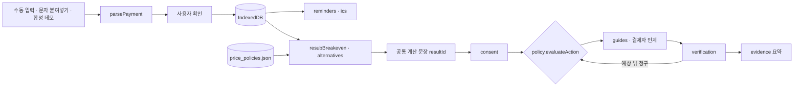

# Design Document — subscription-closure

## Overview
정적 웹앱 하나. 모든 계산과 상태 전이는 `src/domain/*`의 순수 함수가 맡고, 브라우저 경계(IndexedDB·파일)는 `src/adapters/*`가 맡는다. UI는 도메인 결과를 그리기만 한다.

## Architecture

## Components and Interfaces

| 모듈 | 주요 함수 | 요구 |
|---|---|---|
| `domain/money.ts` | `assertWon`, `formatWon`, `formatSignedWon` | R19 |
| `domain/resubBreakeven.ts` | `keepCost`, `pauseCost`, `pauseDelta`, `breakEvenMonths`, `buildTable`, `adviceSentence`, `computeScenario` | R19·R20 |
| `domain/alternatives.ts` | `compareAlternatives(scenario, options, needs)` | R21 |
| `domain/channelPrice.ts` | `compareChannels(table, service, plan, channel, charged)`, `listDifferences`, `switchSteps`, `refundRoute` | R28·R30 |
| `domain/pricePolicy.ts` | `getPolicy(serviceId)`, `planPrices(policy, planId)` | R20 |
| `domain/parsePayment.ts` | `parsePaymentText(text)` → `ParsedCandidate[]` | R01·R02 |
| `domain/reminders.ts` | `decisionDeadline(sub)`, `reviewStatus(sub, today)`, `reviewInbox(subs, today)` | R05·R29 |
| `adapters/ics.ts` | `buildIcs(subs, now)` (D-3·D-1 VALARM) | R06 |
| `domain/consent.ts` | `createProposal`, `reviseProposal`, `castVote`, `revokeVote`, `tally` | R07·R08 |
| `domain/policy.ts` | `evaluateAction(caseState, action, now)` → `{allowed, reasons, next}` | R16 |
| `domain/guides.ts` | `routeFor(serviceId, channel)` | R09·R10 |
| `domain/verification.ts` | `closureStatus(record, now)`, `observeCharge` | R11·R12 |
| `domain/evidence.ts` | `buildSummary(case)` (원문 제외) | R13 |
| `adapters/localStore.ts` | `saveState`, `loadState`, `clearAll` | R15 |

### 핵심 식 (Python 참조 `resub_breakeven.py`와 동치)
- `keep = H × p_old`
- `pause = (H − k) × p_new`
- `delta = keep − pause` (양수 = 쉬는 쪽 이득)
- `breakEven = floor(H × (p_new − p_old) / p_new) + 1` (p_new > p_old일 때. p_new ≤ p_old이면 1). 결과가 H를 넘으면 `null`(기간 안에 이득 없음).

## Data Models
- `Subscription { id, serviceId, planId, name, monthlyWon|null, nextChargeDate|null, channel|null, owner, sharedWith[], sourceKind: 'demo'|'manual'|'sms_paste', evidenceSpans[] }`
- `Scenario { resultId, serviceId, planId, oldWon, newWon, horizon, pauseMonths, keep, pause, delta, breakEven, assumptions[], policyCheckedAt, inputKind: 'example'|'confirmed' }`
- `Proposal { id, caseId, version, terms: { resultId, horizon, pauseMonths, choice, needs[] }, termsHash, requiredMembers[], votes: Vote[] }`
- `Vote { memberId, version, value: 'agree'|'object'|'abstain', at, revoked }`
- `CaseState { caseId, subscriptionId, stage, proposal|null, closure: ClosureRecord, audit: AuditEvent[] }`
- `stage`: `reviewing → family_review → handoff_ready → cancel_requested → awaiting_next_cycle → no_charge_observed_scoped | reopened`
- `ClosureRecord { requestedAt|null, providerConfirmedAt|null, paymentMethod: 'unknown'|'active'|'removed', refund: 'none'|'requested'|'received'|'unknown', expectedNextCharge|null, observedCharges[] }`

## Correctness Properties (fast-check로 검사)
- **P1 손익 항등식**: 모든 유효 입력에서 `delta === keep − pause`, `keep === H×p_old`, `pause === (H−k)×p_new`. [R19]
- **P2 단조성**: k가 1 늘면 delta는 정확히 `p_new`만큼 늘어난다. [R19]
- **P3 손익분기 엄밀성**: `breakEven = b`이면 `delta(b) > 0`이고 `b > 1`일 때 `delta(b−1) ≤ 0`. 동률 0은 이득이 아니다. [R19]
- **P4 Python 동치**: golden 벡터와 모든 값이 같다. [R19]
- **P5 버전 무효화**: 제안을 개정하면 이전 버전의 agree 수는 현재 집계에 0으로 들어간다. [R08]
- **P6 인계 잠금**: 현재 버전에서 필수 구성원 중 한 명이라도 agree가 아니면 `prepare_owner_handoff`는 거부된다. [R07·R16]
- **P7 재청구 재개방**: 해지 요청 이후 관측된 청구가 있으면 상태는 `reopened`이고 `no_charge_observed_scoped`가 아니다. [R12]
- **P8 원문 제외**: 요약 내보내기에 입력 원문 문자열이 들어가지 않는다(합성 canary). [R13]
- **P9 경로 차액**: 차액은 0 이상이고, 차액 > 0이면 (더 싼 경로 가격 + 차액) = 현재 가격. verified가 아닌 가격으로는 차액을 만들지 않는다. [R28]
- **P10 경로 이동 청구 구분**: 새 경로 청구는 사건을 다시 열지 않고, 이전 경로 청구는 항상 다시 연다. [R30]

## Error Handling
- 입력 검증 실패는 예외 대신 `{ ok: false, error: 'not_integer'|'negative'|'k_out_of_range'|'horizon_invalid' }`를 돌려 UI가 그대로 보여 준다.
- 저장 실패는 화면 상단에 "저장 실패 — 이 기기에서만 임시 유지"를 띄우고 상태를 바꾸지 않는다. [R15]

## Testing Strategy
- `tests/domain/*.test.ts`: 단위 + 속성(P1~P8). golden 벡터는 Python 참조에서 생성한 JSON을 그대로 읽는다.
- Kiro 훅 `test-on-save`가 `src/**`·`tests/**` 저장 때 `npm test`를 돌려 `docs/evidence/hook-log.jsonl`에 남긴다.
